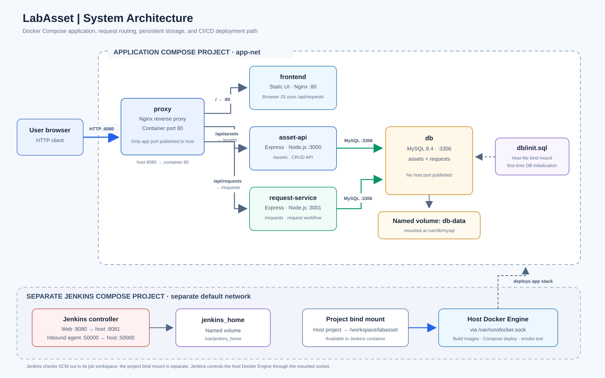

# LabAsset

Containerized laboratory asset and equipment-request system with a Jenkins CI/CD pipeline.

## Project description

LabAsset provides a browser-based interface for submitting and managing laboratory equipment requests, alongside an asset-management API. The system is split into Docker containers: an Nginx reverse proxy, a static web frontend, two Node.js/Express API services, and a MySQL database. Docker Compose connects the application services on a private network and persists MySQL data in a named volume.

The frontend currently reads and updates equipment requests through the request service. The asset API is also routed by the proxy, but is not currently called by the frontend.

## Architecture



The application is entered through the proxy at [http://localhost:8080](http://localhost:8080). Nginx serves the frontend at `/`, forwards `/api/assets...` to the asset API, and forwards `/api/requests...` to the request service. Both APIs connect to MySQL over the internal `app-net`; the database port is not published on the host. The named volume `db-data` persists database files across container recreation.

Jenkins runs in a separate Compose project and network. It checks out the configured repository revision, runs the pipeline, and controls the host Docker Engine through the mounted Docker socket to build and deploy the application stack. Jenkins does not join `app-net`.

### Services and ports

| Service | Technology | Container port | Host access |
|---|---|---:|---|
| `proxy` | Nginx reverse proxy | 80 | `8080` (published; application entry point) |
| `frontend` | Static site served by Nginx | 80 | Not published; accessed through `proxy` |
| `asset-api` | Node.js / Express | 3000 | Not published; accessed through `proxy` |
| `request-service` | Node.js / Express | 3001 | Not published; accessed through `proxy` |
| `db` | MySQL 8.4 | 3306 | Not published; private to `app-net` |
| Jenkins controller | Jenkins LTS | 8080 | `8081` (web interface) |
| Jenkins inbound agents | Jenkins agent listener | 50000 | `50000` |

The five application services join the Compose network `app-net`. Jenkins has its own project network. The application database volume is `db-data`; Jenkins state is stored in `jenkins_home`. The application Compose file also mounts `db/init.sql` for initial database setup.

## Prerequisites

- Docker Engine (or Docker Desktop with Linux containers) and Docker Compose v2.
- Git, with access to the repository used by the Jenkins job.
- Host ports `8080`, `8081`, and `50000` available.
- For Jenkins deployment: a Linux-compatible Docker socket available at `/var/run/docker.sock`, and a Jenkins Pipeline job configured to access this repository and its Docker daemon. Docker socket access effectively grants host-level Docker control; restrict access to the Jenkins instance and its credentials.
- Database credentials for the application. The values in `.env.example` are placeholders; replace them with unique credentials before starting a deployment.

## Start the application stack locally

From the repository root, copy the environment template and edit `.env` to set non-placeholder credentials:

```powershell
Copy-Item .env.example .env
```

Start and build the application:

```sh
docker compose up --build -d
docker compose ps
```

Open [http://localhost:8080](http://localhost:8080). Stop the containers when finished:

```sh
docker compose down
```

This preserves the `db-data` named volume. Do not use `docker compose down -v` unless you intend to delete the persisted database data. The `db/init.sql` initialization script is applied when MySQL creates a new data directory; changing the script does not reinitialize an existing database volume.

## Start Jenkins

Start the separate Jenkins controller from the repository root:

```sh
docker compose -f infra/jenkins/docker-compose.yml up -d --build
```

Open [http://localhost:8081](http://localhost:8081) to complete Jenkins first-time setup. The Compose configuration persists Jenkins state in `jenkins_home`, mounts the Docker socket, and makes the project available at `/workspace/labasset` inside the controller.

Create a Pipeline job configured to use this repository's `Jenkinsfile` (for example, a Pipeline script from SCM job). Configure the Jenkins credential ID `labasset-env` as a **Secret file** containing these environment-variable assignments:

```dotenv
DB_ROOT_PASSWORD=<strong-root-password>
DB_NAME=labasset_db
DB_USER=appuser
DB_PASSWORD=<strong-application-password>
```

Do not commit `.env`, put actual credentials in this README, or expose Jenkins/Docker socket access to untrusted users.

## Jenkins pipeline and automatic trigger

The trigger is declared in the repository [`Jenkinsfile`](./Jenkinsfile):

```groovy
triggers {
    pollSCM('H/1 * * * *')
}
```

This configures Jenkins SCM polling at approximately one-minute intervals using Jenkins' hashed-minute schedule. When a change is detected, the configured Pipeline job runs these stages:

1. **Checkout** — checks out the SCM revision configured for the job.
2. **Test** — checks JavaScript syntax for the asset API, frontend, and request service, and checks that the frontend contains the `LabAsset Portal` marker.
3. **Build Images** — substitutes the Jenkins build number in the frontend and builds the application images.
4. **Deploy** — loads the `labasset-env` Jenkins Secret file and runs `docker compose up -d --no-build --remove-orphans`.
5. **Smoke Test** — checks the frontend, asset API, and request API over the published proxy endpoint.
6. **Mark Stable** — after all smoke tests pass, tags the verified images as `stable` for rollback.

A failed test prevents the build and deployment stages from running. If deployment or a smoke test fails, the pipeline attempts to redeploy the most recently verified `stable` images and reruns the smoke tests. Rollback requires a complete set of stable images; before the first successful pipeline run, no stable set may exist, so automatic rollback cannot proceed. This repository configures SCM polling, not a webhook. A working automatic trigger also depends on the Jenkins job being connected to this repository and the job having SCM polling enabled through its Pipeline definition.

> The smoke tests use `host.docker.internal` to reach the host from Jenkins. Confirm that this hostname resolves from the Jenkins container on the target Docker host.

## Team members and roles

Member names below are the first names currently recorded in the project documentation. Full names and individual responsibilities are **to be confirmed by the team**.

| Member | Role / responsibility |
|---|---|
| Aki | To be confirmed |
| Justine | To be confirmed |
| Kaith | To be confirmed |
| Sean | To be confirmed |

## Further documentation

See the [architecture diagram](./architecture.svg) for the service layout, request flow, ports, networks, and storage. This README documents the project setup and Jenkins workflow.

## Troubleshooting

### Application does not open

- Check whether the Docker containers are running.
- Run `docker compose ps` from the project directory.
- Review the logs with `docker compose logs`.

### Application changes do not appear

- Check the latest Jenkins build and confirm that all pipeline stages passed.
- Verify that the new code was pushed to the Git repository.
- Refresh the browser after deployment completes.

### Database connection problems

- Check whether the database container is healthy.
- Verify that the required database environment variables are configured.
- Review the database and API logs for connection errors.

### Deployment fails

- Open the failed Jenkins build and inspect its console output.
- Identify the stage that failed before attempting another deployment.
- Follow the project's documented rollback procedure if recovery is needed.
